# sales-analysis-mysql-looker
SQL-based sales analysis: monthly trends, top products, customer spending, and a dashboard in Looker Studio.

This project analyzes sales data using **MySQL queries** and **Looker Studio** for the dashboard.

The data has 4 tables: `customers`, `products`, `orders`, and `sales`.

---

## Setup

1. Open XAMPP (`manager-osx`).
2. Start **MySQL Database** and **Apache Web Server**.
3. Open http://localhost/phpmyadmin/
4. Create a new database named `project_db`.
5. Import the 4 files (the first row of each file is the header).
6. Set the **primary keys** and **foreign keys** for each table.
7. Open the **Designer** tab in phpMyAdmin and create the relationships between tables.
8. Change the date columns from `VARCHAR` to `DATE`:

```sql
ALTER TABLE `orders` CHANGE `order_date` `order_date` DATE NULL DEFAULT NULL;
ALTER TABLE `orders` CHANGE `delivery_date` `delivery_date` DATE NULL DEFAULT NULL;
```

---

## Data Cleaning

Before analyzing, I checked the data quality.

**1. Duplicate customers** (same name and address)

```sql
SELECT customer_name, address, COUNT(*) AS duplicate_count
FROM customers
GROUP BY customer_name, address
HAVING COUNT(*) > 1;
```

**2. NULL and empty values**

```sql
SELECT *
FROM customers
WHERE customer_name IS NULL OR TRIM(customer_name) = '';

SELECT *
FROM products
WHERE product_name IS NULL
   OR TRIM(product_name) = ''
   OR price IS NULL
   OR quantity IS NULL;

SELECT *
FROM sales
WHERE product_id IS NULL
   OR quantity IS NULL
   OR price_per_unit IS NULL
   OR total_price IS NULL;
```

**3. Check sales calculation** (`price_per_unit × quantity` should equal `total_price`)

```sql
SELECT COUNT(*) AS mismatch_count
FROM sales
WHERE price_per_unit * quantity <> total_price;
```

**4. Compare sales price with product price**

```sql
SELECT COUNT(*) AS mismatch_count
FROM sales s
JOIN products p
    ON s.product_id = p.product_ID
WHERE s.price_per_unit <> p.price;
```

**5. Check value ranges** (to find strange values)

```sql
SELECT
    (SELECT MIN(age) FROM customers) AS min_age,
    (SELECT MAX(age) FROM customers) AS max_age,
    (SELECT MIN(price) FROM products) AS min_price,
    (SELECT MAX(price) FROM products) AS max_price,
    (SELECT MIN(quantity) FROM products) AS min_quantity,
    (SELECT MAX(quantity) FROM products) AS max_quantity,
    (SELECT MIN(order_date) FROM orders) AS earliest_order,
    (SELECT MAX(order_date) FROM orders) AS latest_order;
```

**6. Check country and state**

```sql
SELECT country, COUNT(DISTINCT state) AS jumlah_state, COUNT(*) AS jumlah_customer
FROM customers
GROUP BY country;
```

Result: there is only **1 country** and **8 states**.

---

## Business Questions

1. How is our sales performance over this period? Are there time patterns we should watch?
2. Which products are the best sellers? Is any category falling behind?
3. How much do our customers spend?
4. Which region is the main market, and which one is still weak?
5. Who are our customers, and which age group matters most?
6. How many registered customers actually buy something?
7. Does the pattern change by month, product, or region?

## Analysis Decisions

- Revenue = `SUM(sales.total_price)`, not payment.
- Gender is not merged into "Other".
- The sample size per gender is small (about 100), so don't over-interpret it.

---

## Analysis

### 1. Orders, quantity sold, and revenue per month

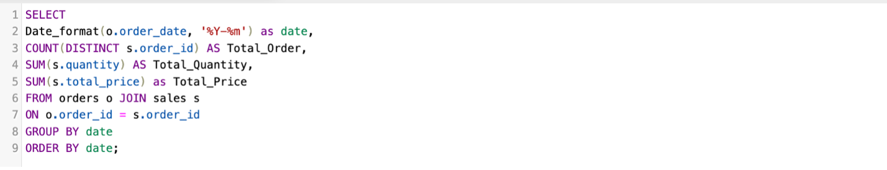

Result:

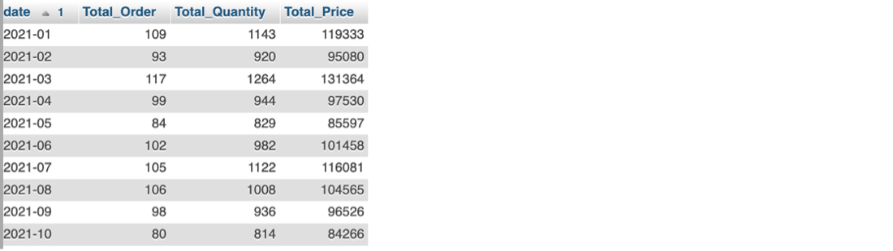

### 2. Best-selling product type (quantity and revenue)

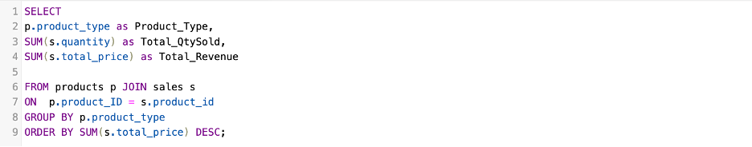

Result:

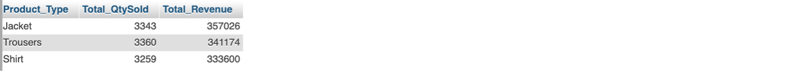

### 3. AOV per order, average spending per customer, and average quantity

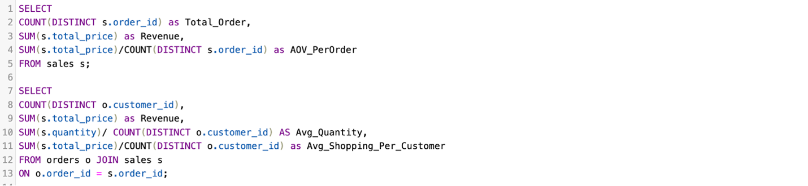

Result:


### 4. Average delivery time per state

This one may not be used in the final dashboard.

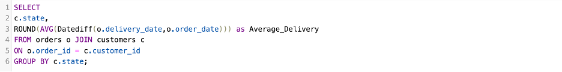

Result:

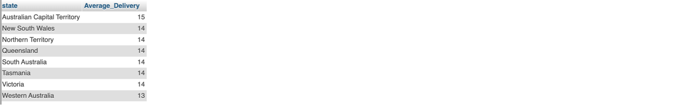

### 5. Customers and revenue per state

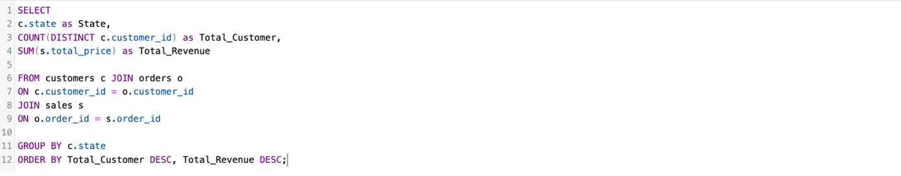

Result:

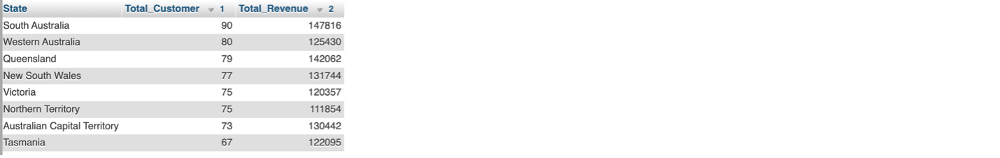

### 6. Active customers who order more than once, and their revenue contribution

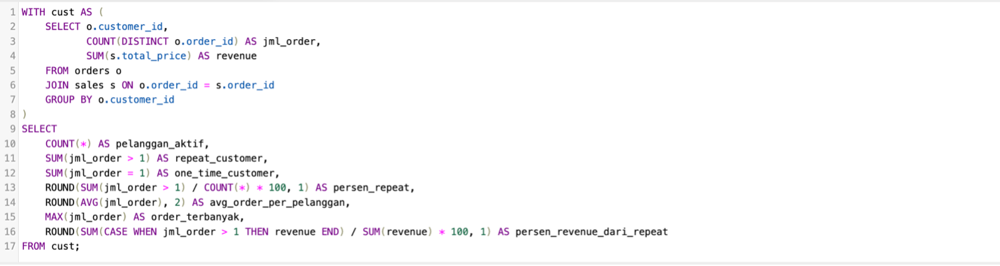

Result:


### 7. Revenue per age group (target market)

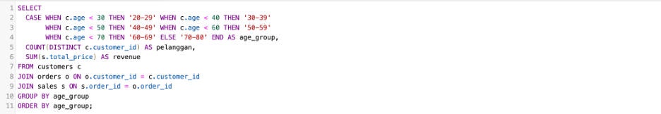

Result:

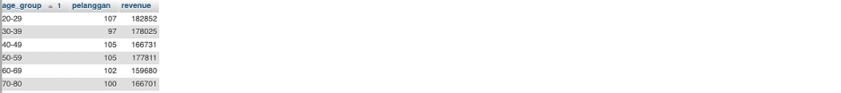

---

## Dashboard

Made with Looker Studio.

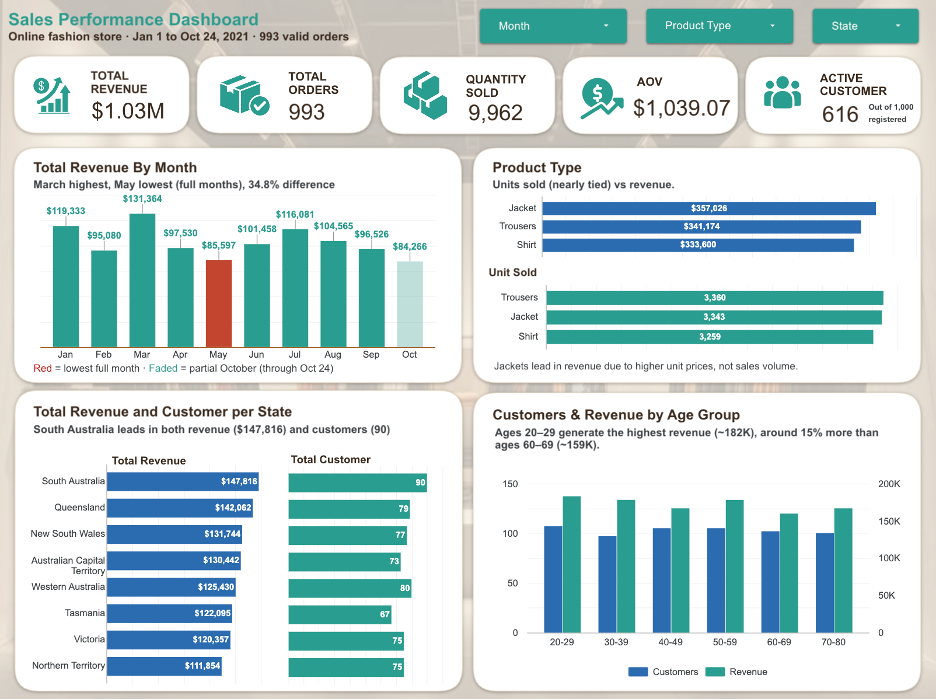

---

## Insights

1. Total revenue is $1.03M from 993 orders, with 9,962 items sold. The average order value (AOV) is $1,039.07.
2. March has the highest revenue ($131,364). May has the lowest full month ($85,597). The gap is about 34.8%.
3. October is not a full month (data stops on Oct 24), so its low revenue should not be compared directly with the other months.
4. The three product types sell almost the same amount of units (about 3,300 each), so no product is really behind.
5. Jacket has the highest revenue ($357,026), even though it is not the top in units sold. This is because the jacket price is higher.
6. South Australia is the top state, both in revenue ($147,816) and in customers (90).
7. Northern Territory has the lowest revenue ($111,854). Tasmania has the fewest customers (67).
8. Only 616 out of 1,000 registered customers have ordered. That means about 38% of registered customers have never bought anything.
9. Age 20-29 brings the highest revenue (about 182K), around 15% more than age 60-69 (about 159K). But the difference between age groups is not very big.

## Recommendations

1. Look into why May is low. Check if there is a holiday or no promotion that month, and try running a promo in slow months.
2. Promote jackets more, because each sale gives more revenue. Trousers and shirts can be sold as bundles with jackets.
3. Keep focusing on South Australia, and try to grow the weaker states like Northern Territory and Tasmania (for example with local ads or free shipping).
4. Send emails or vouchers to the customers who registered but never ordered, to turn them into active customers.
5. Use ages 20-29 as the main target for campaigns, but don't ignore other age groups because they are quite close.
6. Get the full October data before making a final conclusion about the monthly trend.
